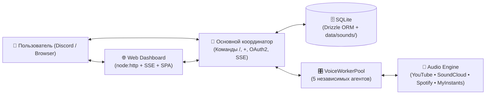

<div align="center">

# 🎧 DBot — Multi-Agent Discord Music & Soundboard Bot

**Многоканальный музыкальный Discord-бот с пулом голосовых агентов, саундбордом (MyInstants + свои звуки) и встроенной real-time веб-панелью управления.**

[](https://nodejs.org/)
[](https://www.typescriptlang.org/)
[](https://discord.js.org/)
[](https://orm.drizzle.team/)
[](https://www.oracle.com/cloud/free/)

</div>

---

## ✨ Ключевые возможности

- **🎙️ Мульти-канальность (до 5 голосовых агентов одновременно)** — преодолевает ограничение Discord «1 бот = 1 войс на сервере». Разные компании в разных голосовых каналах слушают свою музыку со своей очередью и громкостью. Занятые агенты никогда не переманиваются из чужих комнат.
- **🎵 Кроссплатформенный музыкальный движок** — поддержка **YouTube** (видео, плейлисты, поиск), **SoundCloud** (поиск через API v2, сеты, прямой стриминг) и **Spotify** (треки, альбомы, плейлисты + поиск студийных версий), а также умный режим **Авто**.
- **🌐 Встроенная Real-Time веб-панель управления** — работает в том же процессе Node.js без лишних фреймворков (`node:http` + Server-Sent Events):
  - Авторизация через **Discord OAuth2** или мгновенный вход по одноразовой ссылке `/web`.
  - Отслеживание голосового канала пользователя в реальном времени (управление активно только пока вы в войсе, команды идут строго агенту вашей комнаты).
  - Плеер с прогресс-баром, слайдером громкости, **Drag-and-Drop** сортировкой очереди, мониторингом агентов и настройкой ролей доступа для администраторов.
- **😂 Саундборд + MyInstants API** — поиск и воспроизведение мемов (тренды RU / Global) + загрузка собственных `.mp3/.wav/.ogg` звуков прямо через Discord или веб-панель. Музыка мягко ставится на микро-паузу на время звука и продолжается с той же секунды.
- **⏱️ Умный двойной автовыход** — агент автоматически выходит и возвращается в пул, если **5 минут** в канале нет живых людей или **5 минут** не играет музыка.
- **⚡ Дуальный интерфейс команд** — абсолютно каждая команда работает и как слэш-команда (`/`) с описанием аргументов и автокомплитом, и мгновенно через префикс (`+`).
- **☁️ Оптимизация под Oracle Cloud Always Free** — единый процесс Node.js потребляет ~80–120 МБ RAM в простое и ~200–350 МБ под нагрузкой.

---

## 🏗️ Архитектура



---

## 📋 Команды бота

Все команды поддерживают слэш-формат (`/`) и текстовый префикс (`+` по умолчанию).

| Команда (`/`) | Префикс (`+`) / Алиасы | Описание |
|---|---|---|
| `/play <query> [platform]` | `+play`, `+p` (`yt`, `sc`, `sp`) | Воспроизвести трек/плейлист по ссылке или названию с выбором платформы |
| `/pause` / `/resume` | `+pause`, `+resume` | Пауза и возобновление воспроизведения |
| `/skip [count]` | `+skip [N]`, `+s` | Пропустить текущий или N треков |
| `/stop` | `+stop` | Остановить музыку, очистить очередь и отпустить агента |
| `/queue` | `+queue`, `+q` | Показать текущую очередь воспроизведения |
| `/nowplaying` | `+nowplaying`, `+np` | Карточка текущего трека с прогресс-баром |
| `/volume <1-100>` | `+volume`, `+vol` | Регулировка громкости |
| `/loop <off\|track\|queue>` | `+loop` | Зацикливание трека или очереди |
| `/shuffle` | `+shuffle` | Перемешать треки в очереди |
| `/sound play\|meme\|upload\|list\|delete` | `+sound`, `+sfx`, `+meme` | Саундборд: свои звуки, мемы MyInstants, загрузка файлов |
| `/web` | `+web`, `+panel` | Получить персональную ссылку для мгновенного входа в веб-панель |
| `/health` | `+health` | Диагностика состояния и замер реального времени ответа всех 6 ботов |
| `/workers` | `+workers` | Статус и занятость пула голосовых агентов |
| `/join` / `/leave` | `+join`, `+leave` | Вызвать свободного агента в канал / отпустить его |
| `/note add\|get\|list\|delete` | `+note` | Личные заметки в базе данных SQLite |
| `/ping` / `/info` | `+ping`, `+info` | Проверка задержки и информация о пользователе |

**Примеры выбора платформы в префиксном режиме:**
```text
+play lofi beats              # Автопоиск (YouTube -> фолбэк на SoundCloud)
+play yt rick astley          # Поиск строго в YouTube
+play sc phonk drift          # Поиск и стриминг с SoundCloud
+play sp daft punk            # Студийный трек (метаданные + обложка)
+play https://open.spotify.com/playlist/...   # Весь плейлист до 50 треков
```

---

## 🚀 Быстрый старт (Локально)

### 1. Подготовка приложений в Discord Developer Portal
1. Создайте **основного бота** в [Discord Developer Portal](https://discord.com/developers/applications):
   - Вкладка **Bot** → скопируйте токен и включите **MESSAGE CONTENT INTENT**.
   - Вкладка **OAuth2 → URL Generator** → отметьте `bot`, `applications.commands` и пригласите бота на сервер.
2. Создайте до **5 дополнительных ботов-агентов** (для параллельной работы в разных голосовых каналах):
   - Для каждого скопируйте токен и пригласите на сервер со скоупом `bot` и правами `Connect`, `Speak`, `Use Voice Activity`.

### 2. Установка и настройка
```bash
git clone https://github.com/MarryBye/DBot.git
cd DBot
pnpm install
cp .env.example .env
```

Заполните [.env](.env.example):

| Переменная | Обязательна | Описание |
|---|---|---|
| `DISCORD_TOKEN` | Да | Токен основного бота-координатора |
| `CLIENT_ID` | Да | Application ID основного бота |
| `WORKER_TOKEN_1`..`5` | Да (мин. 1) | Токены голосовых ботов-агентов |
| `PREFIX` | Нет | Префикс текстовых команд (по умолчанию `+`) |
| `PORT` / `HOST` | Нет | Порт и хост веб-панели (по умолчанию `3000` / `0.0.0.0`) |
| `PUBLIC_URL` | Нет | Внешний URL панели (например `http://129.153.x.x:3000`) |
| `DISCORD_CLIENT_SECRET` | Нет | Для кнопки «Войти через Discord» (без него работает вход по `/web`) |
| `SPOTIFY_CLIENT_ID` / `SECRET` | Нет | Опциональные ключи Spotify API |

### 3. Регистрация слэш-команд и запуск
```bash
# Глобальная регистрация слэш-команд
pnpm deploy-commands

# Режим разработки (hot-reload)
pnpm dev

# Продакшен-сборка и запуск
pnpm build
pnpm start:prod
```

---

## ☁️ Деплой на Oracle Cloud (Always Free)

```bash
# 1. Установка зависимостей ОС (Ubuntu)
sudo apt update && sudo apt install -y curl git build-essential python3 ffmpeg
curl -fsSL https://deb.nodesource.com/setup_24.x | sudo -E bash -
sudo apt install -y nodejs
sudo corepack enable && corepack prepare pnpm@latest --activate

# 2. Открытие порта 3000 (также добавьте TCP 3000 в Security List в консоли Oracle Cloud!)
sudo iptables -I INPUT 6 -m state --state NEW -p tcp --dport 3000 -j ACCEPT
sudo netfilter-persistent save

# 3. Клонирование и сборка
git clone https://github.com/MarryBye/DBot.git ~/dbot
cd ~/dbot
cp .env.example .env   # вставьте токены и укажите PUBLIC_URL=http://<ВАШ_IP>:3000
pnpm install
pnpm approve-builds better-sqlite3 esbuild ffmpeg-static
pnpm build
```

Для фоновой работы 24/7 настройте `systemd`-сервис (`/etc/systemd/system/dbot.service`):
```ini
[Unit]
Description=DBot Discord Music & Soundboard Bot
After=network-online.target

[Service]
Type=simple
User=ubuntu
WorkingDirectory=/home/ubuntu/dbot
ExecStart=/usr/bin/node /home/ubuntu/dbot/dist/index.js
Restart=always
RestartSec=5
Environment=NODE_ENV=production

[Install]
WantedBy=multi-user.target
```
```bash
sudo systemctl daemon-reload
sudo systemctl enable --now dbot
```

**Обновление бота на сервере в 1 строку:**
```bash
cd ~/dbot && git pull && pnpm install && pnpm build && sudo systemctl restart dbot
```

---

## 📁 Структура проекта

```text
DBot/
├── public/                 # SPA веб-панель (HTML, CSS, Vanilla JS + SSE)
├── src/
│   ├── commands/           # 19 дуальных команд (/ и +)
│   ├── db/                 # Схема Drizzle ORM и инициализация SQLite
│   ├── voice/              # VoiceWorkerPool, AudioQueue, MusicResolver, Soundboard (MyInstants)
│   ├── web/                # Встроенный HTTP-сервер, Auth (OAuth2 + /web), SSE
│   ├── config.ts           # Конфигурация окружения
│   ├── deploy-commands.ts  # Глобальная публикация слэш-команд
│   └── index.ts            # Точка входа бота
├── .env.example            # Шаблон переменных окружения
├── drizzle.config.ts       # Конфигурация Drizzle Kit
└── tsconfig.json           # Настройки TypeScript
```

---

## 📄 Лицензия

Распространяется под лицензией **ISC**.
